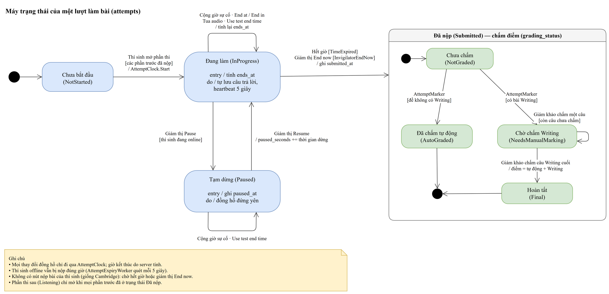

# Xây dựng Website hỗ trợ thi chứng chỉ tiếng Anh Cambridge

Đồ án chuyên ngành — Khoa Công nghệ Thông tin, Trường Kỹ thuật và Công nghệ.

Hệ thống thi tiếng Anh trên máy tính cho phòng thi của **Trung tâm Anh ngữ Victory**, tái hiện trải nghiệm thi máy Cambridge (nền tảng Inspera): bố cục đề, định dạng câu hỏi, giao diện thí sinh và cổng giám thị. Làm trước **A2 Key for Schools**, sau đó **B1 Preliminary for Schools**, cuối cùng là IELTS.

Quy trình gồm: nhập đề và đáp án, tạo kỳ thi, cấp tài khoản thí sinh, thí sinh làm bài trong trình duyệt khóa tại trung tâm, giám thị theo dõi cả phòng theo thời gian thực và xử lý sự cố, hệ thống tự chấm Reading/Listening theo đáp án, giáo viên chấm Writing.

> Hệ thống **không** kết nối với hệ thống thật của Cambridge/Inspera. Đề thi do trung tâm Victory cung cấp; repository công khai không chứa đề thật.

## Thông tin

| | |
|---|---|
| **Sinh viên** | Trần Hoàng Long — MSSV 110123025 — Lớp DA23TTA |
| **Email** | thlong190705@gmail.com |
| **Điện thoại** | 0342478051 |
| **GVHD** | ThS. Nhan Minh Phúc |

## Bài toán

Thi máy khó ở khâu vận hành: giám thị phải tạm dừng đúng thí sinh, cộng giờ bù, tua lại phần nghe khi lỗi âm thanh, và không được bấm nhầm lệnh kết thúc (không hoàn tác được). Buổi tập huấn chính thức chỉ ~20 phút mỗi phần, tài khoản thí sinh ảo dùng một lần. Website này cho phép:

- **Thí sinh** thi thử, làm quen giao diện thi máy.
- **Giám thị** tập các thao tác xử lý sự cố.
- **Trung tâm** kiểm tra phòng máy và tổ chức thi thử bằng đề tự soạn.

## Chức năng chính

- **Mô hình hai tầng:** một kỳ thi (Parent) gồm nhiều phần thi (Child), số phần và thứ tự tùy loại bài thi — mỗi phần giám sát riêng.
- **Đồng hồ làm bài do server nắm**, tự nộp khi hết giờ.
- **Cổng giám thị thời gian thực (SignalR):** bảng theo dõi cả phòng, chọn nhiều thí sinh thao tác cùng lúc; tạm dừng / làm tiếp, cộng giờ bù, sửa giờ kết thúc (*End now / End at / End in*), tua lại phần nghe.
- **Màn hình thí sinh:** vào thi bằng mã PIN, làm bài, ghi chú, đánh dấu câu, đổi cỡ chữ và độ tương phản.
- **Safe Exam Browser:** server kiểm tra cấu hình SEB (Browser Exam Key) mới cho vào thi; vi phạm hiển thị cảnh báo cho giám thị.
- **Năm vai trò** (theo yêu cầu Victory 16/10/2026): **admin** tạo mọi tài khoản nhân sự; **quản trị viên** phụ trách từng mảng (đề thi, kỳ thi, thí sinh, trung tâm) — được tạo và sửa, không được xoá; **giám khảo** xem lại bài làm, chấm Writing và xem kết quả của kỳ thi được phân công (chỉ giám khảo mở được bài làm); **giám thị**; **thí sinh**.
- **Trộn đề** (theo yêu cầu Victory 20/10/2026): hai đề gốc cùng khuôn được trộn theo từng part thành 4 đề; đề chia theo vị trí máy (khối 2×2) nên hai máy kề nhau — ngang, dọc, chéo — không bao giờ cùng đề; thí sinh đổi máy giữa giờ vẫn giữ đề đã làm.
- **Hai admin duyệt chéo:** mọi thao tác xoá (đề, kỳ thi, thí sinh) và thay đổi tài khoản (khoá/mở, đổi vai trò, đặt lại mật khẩu, thêm admin) thành yêu cầu chờ một admin *khác* duyệt; ai yêu cầu không tự duyệt được, mọi yêu cầu được lưu làm nhật ký.

**Ngoài phạm vi:** các cấp B2 First, C1 Advanced, C2 Proficiency; phần Speaking (thi trực tiếp); máy Mac/Chromebook; chạy nhiều server.

## Bài thi hỗ trợ

| Bài thi | Phần thi trên máy (theo thứ tự) |
|---|---|
| A2 Key for Schools | Reading & Writing (60 phút) → Listening (~30 phút) |
| B1 Preliminary for Schools | Reading (45 phút) → Writing (45 phút) → Listening (~30 phút) |
| IELTS Academic / General Training | Listening (~30 phút) → Reading (60 phút) → Writing (60 phút) |

Cả ba bài thi đều triển khai trên cùng hệ thống Inspera, nên **quy trình làm bài và giám sát giống hệt nhau**; chỉ khác danh sách phần thi. Speaking thi trực tiếp, không làm trên hệ thống.

Thời lượng A2 Key và B1 Preliminary lấy theo *Exam Day Booklet for Digital exams (01/2026)*. Thời lượng IELTS lấy theo cấu trúc chuẩn của IELTS trên máy.

## Công nghệ

| Thành phần | Công nghệ |
|---|---|
| Backend | C#, ASP.NET Core Web API (.NET 10) |
| Thời gian thực | SignalR |
| Cơ sở dữ liệu | MySQL + Entity Framework Core |
| Frontend | React |
| Khóa trình duyệt | Safe Exam Browser (Windows) |

## Cấu trúc thư mục

Theo hướng dẫn tổ chức repository của Khoa:

```
├── docker/             docker-compose: MySQL + API + web (.env.example mẫu)
├── setup/              Bộ cài đặt, dữ liệu thử, hướng dẫn triển khai
├── src/
│   └── backend/        ASP.NET Core (.NET 10): Domain, Infrastructure (EF Core), Api, Tests
├── progress-report/    Báo cáo tiến độ hằng tuần (bắt buộc)
└── thesis/             Tài liệu đồ án (bắt buộc)
    ├── doc/            Đề cương chi tiết, báo cáo (.docx)
    ├── pdf/            Bản PDF
    ├── html/           Tài liệu dạng web
    ├── abs/            Slide, video trình bày
    ├── diagrams/       Sơ đồ thiết kế draw.io (use case, ERD)
    └── refs/           Tài liệu tham khảo
        ├── faculty-templates/   Quy định chung, mẫu đề cương/báo cáo, lịch thực hiện
        ├── cambridge-digital/   Tài liệu thi máy Cambridge / Inspera
        ├── inspera-ui-a2.md     Ghi chép giao diện bài thi mẫu A2 Key for Schools
        └── ielts-format.md      Format đề và dạng câu hỏi IELTS
```

## Thiết kế

Sơ đồ nguồn `.drawio` mở bằng [draw.io](https://www.drawio.com/); file `.drawio.png` có nhúng sơ đồ nên cũng mở lại để sửa được.

### Sơ đồ Use Case tổng quát


### Sơ đồ thực thể – quan hệ (ERD)


### Sơ đồ trạng thái lượt làm bài



### Sơ đồ tuần tự

- [Thí sinh đăng nhập và bắt đầu phần thi](thesis/diagrams/seq-candidate-login.drawio.png)
- [Giám thị tạm dừng thí sinh (SignalR)](thesis/diagrams/seq-invigilator-pause.drawio.png)
- [Duyệt chéo hai admin](thesis/diagrams/seq-approval.drawio.png)

Đặc tả yêu cầu và đặc tả thiết kế + API (Word) nằm trong [thesis/doc](thesis/doc).

## Kế hoạch thực hiện

| Tuần | Thời gian | Nội dung |
|---|---|---|
| 1 | 19/10 – 25/10/2026 | Thực hiện đề tài, GV hướng dẫn |
| 2 | 09/11 – 15/11/2026 | Thực hiện đề tài, GV hướng dẫn |
| 3 | 30/11 – 06/12/2026 | Thực hiện đề tài, GV hướng dẫn |
| 4 | 21/12 – 27/12/2026 | Hoàn thiện, viết và chỉnh sửa quyển báo cáo |
| — | 31/12/2026 | Nộp quyển báo cáo tại Văn phòng Khoa |

## Cài đặt & chạy

### Chạy cả hệ thống bằng Docker (một lệnh)

Hướng dẫn đầy đủ cho phòng thi (máy thí sinh qua mạng LAN, sao lưu, xử lý sự cố): [setup/INSTALL.md](setup/INSTALL.md).

Chỉ cần Docker Desktop. MySQL, API và giao diện chạy trong ba container; API tự tạo bảng, tạo tài khoản admin đầu tiên và kỳ thi demo A2.

```bash
cp docker/.env.example docker/.env        # rồi đổi mật khẩu MySQL và BOOTSTRAP_ADMIN_* trong docker/.env
docker compose -f docker/docker-compose.yml --env-file docker/.env up -d --build
```

Mở http://localhost:8080 (thí sinh) và http://localhost:8080/staff (nhân sự trung tâm). Tài khoản demo (mục `Demo` của `src/backend/src/ExamPrep.Api/appsettings.Development.json`, chỉ dùng khi chạy thử):

| Vai trò | Địa chỉ | Tên đăng nhập | Mật khẩu |
|---|---|---|---|
| Admin | `/staff` | `hoanglong` | `19072005` |
| Admin thứ hai (duyệt yêu cầu) | `/staff` | `admin2` | `19072005` |
| Quản trị viên (cả bốn mảng) | `/staff` | `quantri` | `19072005` |
| Giám khảo | `/staff` | `giamkhao` | `19072005` |
| Giám thị | `/staff` | `giamthi` | `victory-invig` |
| Thí sinh (Trần Hoàng Long) | `/` | `hoanglong` | `19072005`, mã PIN `4821` |

Thí sinh thật vẫn nhận tên đăng nhập kiểu Cambridge và mật khẩu ngẫu nhiên in trên phiếu. Dừng bằng `docker compose -f docker/docker-compose.yml down` (dữ liệu vẫn giữ).

### Chạy từng phần để phát triển

Yêu cầu: .NET SDK 10, Node.js, Docker Desktop.

```bash
# 1. Cơ sở dữ liệu MySQL
cp docker/.env.example docker/.env        # rồi đổi mật khẩu trong docker/.env
docker compose -f docker/docker-compose.yml --env-file docker/.env up -d mysql

# 2. Chuỗi kết nối cho API (lưu bằng user-secrets, không nằm trong repo)
cd src/backend
dotnet user-secrets set "ConnectionStrings:ExamPrep" "server=localhost;port=3306;database=examprep;user=examprep;password=<MYSQL_PASSWORD>" --project src/ExamPrep.Api

# 3. Tạo bảng
ConnectionStrings__ExamPrep="server=localhost;port=3306;database=examprep;user=examprep;password=<MYSQL_PASSWORD>"   dotnet ef database update -p src/ExamPrep.Infrastructure -s src/ExamPrep.Api

# 4. Chạy API (kiểm tra tại http://localhost:<port>/health)
ASPNETCORE_ENVIRONMENT=Development dotnet run --project src/ExamPrep.Api

# 5. Kiểm thử (test CSDL cần tài khoản root để tạo database tạm)
EXAMPREP_TEST_MYSQL="server=localhost;port=3306;user=root;password=<MYSQL_ROOT_PASSWORD>" dotnet test
```

## Tiến độ

- [x] Đề cương chi tiết (v4)
- [x] Tài liệu tham khảo quy trình thi máy
- [x] Sơ đồ use case tổng quát, ERD
- [x] Khảo sát giao diện bài thi mẫu A2 Key for Schools
- [x] Cơ sở dữ liệu: 25 bảng (EF Core + MySQL), migration, dữ liệu mẫu A2/B1, 16 test tích hợp
- [x] Đặc tả yêu cầu, sơ đồ trạng thái, sơ đồ tuần tự, đặc tả API; hướng dẫn cài đặt (`setup/INSTALL.md`)
- [x] Backend: đăng nhập nhân viên (admin, giám thị) và thí sinh (username/password + PIN phòng thi), phân quyền, đồng hồ server — 78 test
- [x] Nhập đề: định dạng gói đề (`setup/exam-package/FORMAT.md`), import có kiểm tra lỗi, đề mẫu A2 tự soạn — 116 test
- [x] Bộ chuyển đề PDF → gói đề cho Reading & Writing A2 (đề mẫu A2 2022: 32 câu, 12 hình, import được) — 35 test Python
- [x] Bộ chuyển đề Listening (mỗi part một file audio) và "Import from PDF" trong cổng nhân viên
- [x] Màn hình thí sinh A2 Reading & Writing kiểu Inspera (React + TS), kỳ thi demo — 21 test frontend
- [x] Đồng hồ server, tự lưu, hết giờ tự nộp; Listening phát một lần, kéo thả
- [x] Chấm tự động Reading Part 1–5 và Listening theo đáp án; API kết quả cho nhân viên — 182 test backend, 48 test frontend
- [x] Cổng nhân viên `/staff`: quản trị đề (import, xuất bản), kỳ thi (gắn đề, PIN, mật khẩu giám thị), thí sinh (dán từ Excel, username kiểu Cambridge, in phiếu), tài khoản giám thị và phân công; trang theo dõi của giám thị (tạm dừng, cộng giờ sự cố, Edit End Time, tua audio, thông báo) — 218 test backend, 60 test frontend
- [x] Màn hình thí sinh: menu Options (độ tương phản, cỡ chữ, ẩn giờ), highlight và ghi chú; F5 quay lại đúng bài
- [x] Chấm Writing cho giáo viên, tổng điểm cuối, xuất kết quả CSV mở bằng Excel
- [x] Rà soát bảo mật 13/10: khoá tài khoản khi sai mật khẩu/PIN liên tục, lưu khoá mã hoá, security header, xử lý lỗi an toàn — 231 test backend, 71 test frontend
- [x] Vai trò mới của Victory (16/10): quản trị viên theo mảng, giám khảo (chỉ giám khảo xem bài làm), hai admin duyệt chéo mọi thao tác xoá và thay đổi tài khoản, trang Approvals — 268 test backend, 82 test frontend
- [x] Cập nhật thời gian thực bằng SignalR: trang giám thị đổi trong ≤ 2 giây, lệnh tạm dừng đến máy thí sinh ngay — 274 test backend, 84 test frontend
- [x] Safe Exam Browser (kiểm tra Config Key trên mọi yêu cầu của thí sinh), cột cảnh báo cho giám thị (không dùng SEB, mất kết nối, đồng hồ máy lệch, làm trước khi giám thị báo bắt đầu); viết cả đề A2 trên web (đề trắng theo khung A2) và sửa đề nháp; đổi tên và logo trung tâm — 291 test backend, 88 test frontend
- [x] Trộn đề (Victory 20/10): đề gốc thứ hai A2 Key (công cụ `split_listening.py` tách file nghe theo part), `POST /api/admin/paper-mixes` sinh 4 đề từ 2 đề gốc theo từng part, phần thi chia đề theo số máy (khối 2×2), lượt làm bài giữ đề khi đổi máy — 350 test backend, 60 test bộ chuyển đề
- [x] Giao diện trộn đề trên cổng nhân viên (VE-67): Papers → "Mix two papers" và bảng đề trộn; form kỳ thi chọn bộ trộn cho từng phần thi và số máy mỗi hàng; sơ đồ phòng in được kèm mã đề; cột mã đề ở danh sách thí sinh, trang giám thị, bảng kết quả (cả file CSV) và trang chấm — 353 test backend, 91 test frontend
- [x] B1 Preliminary for Schools: khảo sát bài thi mẫu trên Inspera (`thesis/refs/inspera-ui-b1.md`); Reading đủ 6 part, thêm hai dạng kéo thả của B1 (ghép người với thẻ văn bản dài, kéo câu vào ô trống trong bài), đề mẫu B1 Reading tự soạn
- [x] Bộ chuyển đề PDF → gói đề cho B1 Preliminary (Reading, Writing, Listening; đáp án có từ tuỳ chọn), tách file nghe B1 theo part, "Import from PDF" nhận đề B1 — 69 test Python
- [x] B1 Listening 4 part: Part 2 mỗi câu một trang (cờ `questionPerPage` trên part), đề mẫu tự soạn có audio đọc máy
- [x] B1 Writing: Part 2 chọn 1 trong 2 câu ("Answering this question? Yes/No/Undecided"), giám khảo chỉ chấm câu được chọn, đề mẫu tự soạn
- [ ] Triển khai HTTPS cho phòng thi thật
- [x] Test đầu-cuối Playwright (`npm run e2e`, stack Docker riêng cổng 8090): thí sinh đăng nhập + PIN + làm bài + tải lại trang; giám thị tạm dừng/cho làm tiếp và máy thí sinh nhận ngay; quản trị viên tạo đề trắng, gửi yêu cầu xoá, admin khác duyệt; giám thị End now → chấm tự động → giám khảo chấm Writing → điểm Final (chạy lại thì `down -v` stack trước)
- [ ] Kiểm thử tải, buổi thi thử
- [ ] Quyển báo cáo
