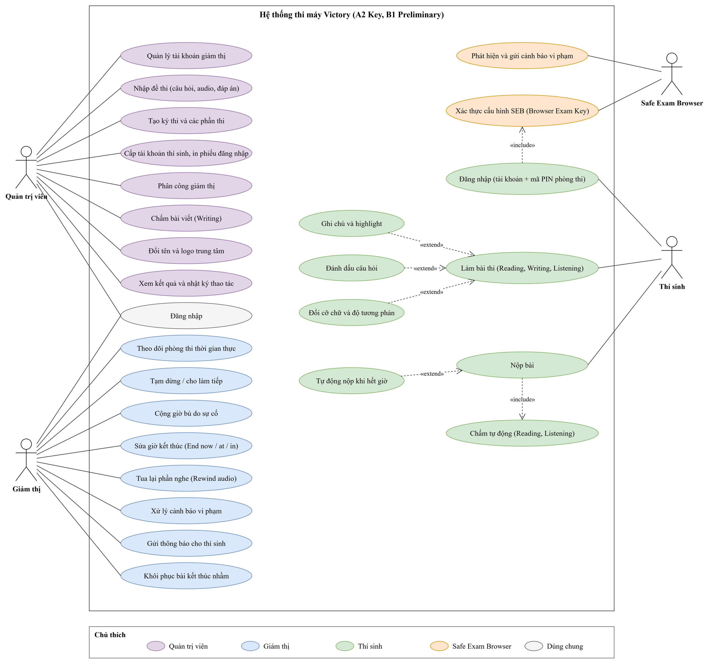
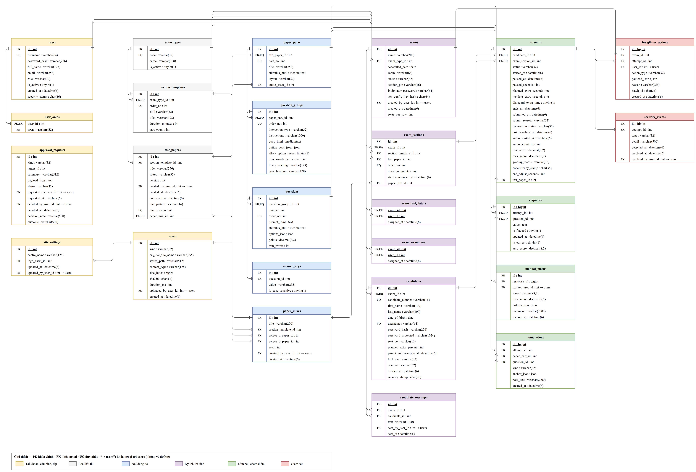

# Xây dựng Website hỗ trợ thi chứng chỉ tiếng Anh Cambridge

Đồ án chuyên ngành — Khoa Công nghệ Thông tin, Trường Kỹ thuật và Công nghệ.

Website mô phỏng trọn một buổi **thi tiếng Anh trên máy tính** cho **A2 Key, B1 Preliminary và IELTS**: tạo kỳ thi, cấp tài khoản thí sinh, thí sinh làm bài trong trình duyệt khóa, giám thị theo dõi cả phòng theo thời gian thực và xử lý sự cố, thu bài.

> Website **không** dùng đề thi thật của Cambridge và **không** kết nối với hệ thống thật của Cambridge/Inspera. Đề thi là đề tự soạn phục vụ thi thử và tập huấn.

## Thông tin

| | |
|---|---|
| **Sinh viên** | Trần Hoàng Long — MSSV 110123025 — Lớp DA23TTA |
| **Email** | thlong190705@gmail.com |
| **Điện thoại** | 0342478051 |
| **GVHD** | ThS. Nhan Minh Phúc |

## Bài toán

Thi máy khó ở khâu vận hành: giám thị phải tạm dừng đúng thí sinh, cộng giờ bù, tua lại phần nghe khi lỗi âm thanh, và không được bấm nhầm lệnh kết thúc (không hoàn tác được). Buổi tập huấn chính thức chỉ ~20 phút mỗi phần, tài khoản thí sinh ảo dùng một lần. Website này cho phép:

- **Thí sinh** thi thử, làm quen giao diện thi máy.
- **Giám thị** tập các thao tác xử lý sự cố.
- **Trung tâm** kiểm tra phòng máy và tổ chức thi thử bằng đề tự soạn.

## Chức năng chính

- **Mô hình hai tầng:** một kỳ thi (Parent) gồm nhiều phần thi (Child), số phần và thứ tự tùy loại bài thi — mỗi phần giám sát riêng.
- **Đồng hồ làm bài do server nắm**, tự nộp khi hết giờ.
- **Cổng giám thị thời gian thực (SignalR):** bảng theo dõi cả phòng, chọn nhiều thí sinh thao tác cùng lúc; tạm dừng / làm tiếp, cộng giờ bù, sửa giờ kết thúc (*End now / End at / End in*), tua lại phần nghe.
- **Màn hình thí sinh:** vào thi bằng mã PIN, làm bài, ghi chú, đánh dấu câu, đổi cỡ chữ và độ tương phản.
- **Safe Exam Browser:** server kiểm tra cấu hình SEB (Browser Exam Key) mới cho vào thi; vi phạm hiển thị cảnh báo cho giám thị.
- **Ba vai trò:** quản trị, giám thị, thí sinh.

**Ngoài phạm vi:** các cấp B2 First, C1 Advanced, C2 Proficiency; phần Speaking; chấm điểm; máy Mac/Chromebook; chạy nhiều server.

## Bài thi hỗ trợ

| Bài thi | Phần thi trên máy (theo thứ tự) |
|---|---|
| A2 Key | Reading & Writing (60 phút) → Listening (~30 phút) |
| B1 Preliminary | Reading (45 phút) → Writing (45 phút) → Listening (~30 phút) |
| IELTS Academic / General Training | Listening (~30 phút) → Reading (60 phút) → Writing (60 phút) |

Cả ba bài thi đều triển khai trên cùng hệ thống Inspera, nên **quy trình làm bài và giám sát giống hệt nhau**; chỉ khác danh sách phần thi. Speaking thi trực tiếp, không làm trên hệ thống.

Thời lượng A2 Key và B1 Preliminary lấy theo *Exam Day Booklet for Digital exams (01/2026)*. Thời lượng IELTS lấy theo cấu trúc chuẩn của IELTS trên máy.

## Công nghệ

| Thành phần | Công nghệ |
|---|---|
| Backend | C#, ASP.NET Core Web API (.NET 10) |
| Thời gian thực | SignalR |
| Cơ sở dữ liệu | MySQL + Entity Framework Core |
| Frontend | React |
| Khóa trình duyệt | Safe Exam Browser (Windows) |

## Cấu trúc thư mục

Theo hướng dẫn tổ chức repository của Khoa:

```
├── setup/              Bộ cài đặt, dữ liệu thử, hướng dẫn triển khai
├── src/                Mã nguồn (backend ASP.NET Core + frontend React)
├── progress-report/    Báo cáo tiến độ hằng tuần (bắt buộc)
└── thesis/             Tài liệu đồ án (bắt buộc)
    ├── doc/            Đề cương chi tiết, báo cáo (.docx)
    ├── pdf/            Bản PDF
    ├── html/           Tài liệu dạng web
    ├── abs/            Slide, video trình bày
    ├── diagrams/       Sơ đồ thiết kế draw.io (use case, ERD)
    └── refs/           Tài liệu tham khảo
        ├── faculty-templates/   Quy định chung, mẫu đề cương/báo cáo, lịch thực hiện
        └── cambridge-digital/   Tài liệu thi máy Cambridge / Inspera
```

## Thiết kế

Sơ đồ nguồn `.drawio` mở bằng [draw.io](https://www.drawio.com/); file `.drawio.png` có nhúng sơ đồ nên cũng mở lại để sửa được.

### Sơ đồ Use Case tổng quát



### Sơ đồ thực thể – quan hệ (ERD)



## Kế hoạch thực hiện

| Tuần | Thời gian | Nội dung |
|---|---|---|
| 1 | 19/10 – 25/10/2026 | Thực hiện đề tài, GV hướng dẫn |
| 2 | 09/11 – 15/11/2026 | Thực hiện đề tài, GV hướng dẫn |
| 3 | 30/11 – 06/12/2026 | Thực hiện đề tài, GV hướng dẫn |
| 4 | 21/12 – 27/12/2026 | Hoàn thiện, viết và chỉnh sửa quyển báo cáo |
| — | 31/12/2026 | Nộp quyển báo cáo tại Văn phòng Khoa |

## Cài đặt & chạy

Đang phát triển — hướng dẫn cài đặt sẽ được cập nhật trong `setup/` khi có mã nguồn.

## Tiến độ

- [x] Đề cương chi tiết (v4)
- [x] Tài liệu tham khảo quy trình thi máy
- [x] Sơ đồ use case tổng quát, ERD
- [ ] Đặc tả yêu cầu, sơ đồ trạng thái, sơ đồ tuần tự, đặc tả API
- [ ] Backend: đăng nhập, phân quyền, quản lý kỳ thi/thí sinh, đồng hồ server
- [ ] Màn hình thí sinh & cổng giám thị
- [ ] Tích hợp Safe Exam Browser, đóng gói
- [ ] Kiểm thử tình huống, kiểm thử tải, buổi thi thử
- [ ] Quyển báo cáo
